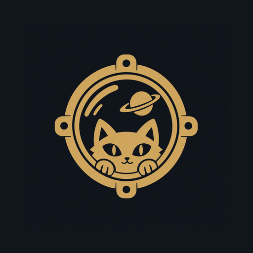
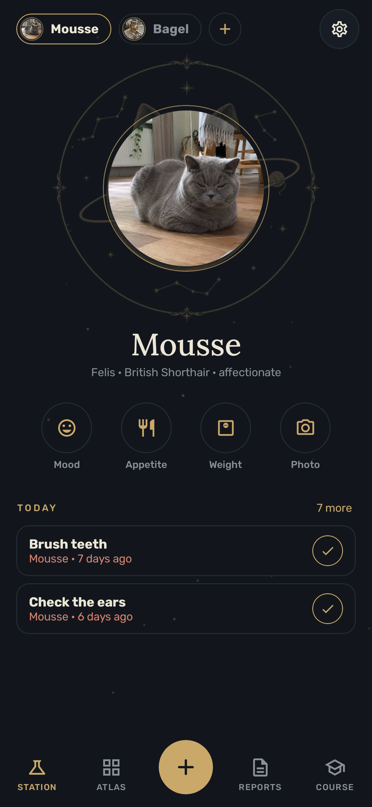
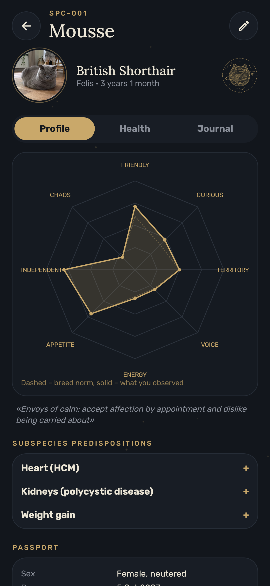
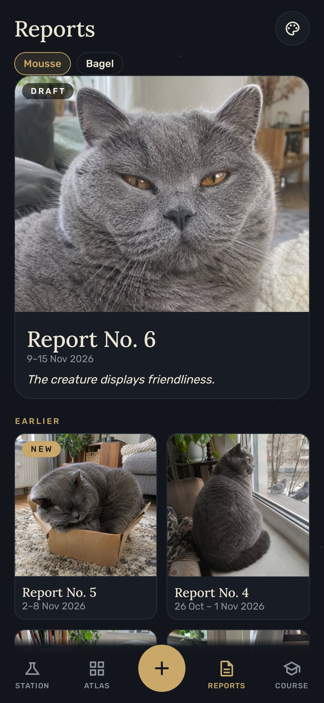
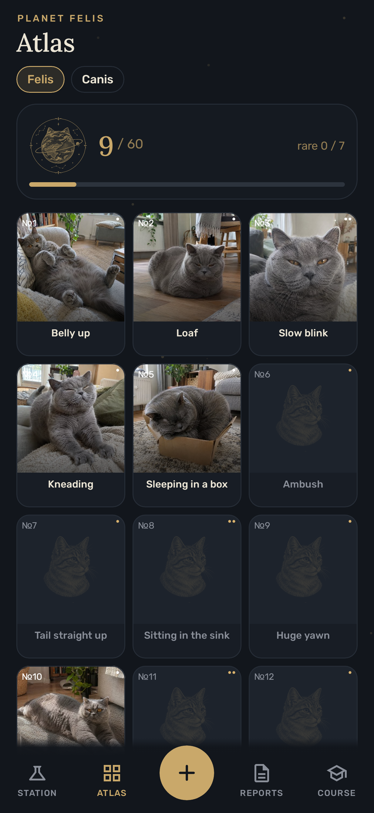

<h1 align="center">Specimen</h1>

A diary of your pet – who, it turns out, came from another planet. 
<a href="https://bigdevwhale.github.io/stillcraft/apps/specimen/">Website</a> · <a href="https://github.com/bigdevwhale/specimen/releases/latest/download/Specimen.apk">Download APK</a> · <a href="README.ru.md">Русский</a>

Your cat, dog or parrot is an envoy from another world, and you are the xenologist assigned to observe it. Log its mood, appetite and weight, photograph it, try new foods – and every week the bureau files a report: your photos, the conclusions, and the new skills the creature has shown.

## What's inside

- **Six home planets, 135 breeds.** Cats, dogs, parrots, rabbits and rodents, ferrets, reptiles. For each breed the app knows the temperament, the usual weight and what it tends to suffer from.
- **One-tap logging.** Mood, appetite, weight, stool, symptoms and notes. When something looks worrying – a cat that hasn't eaten for two days or can't pee – the app says plainly that it's time to see a vet.
- **Life support.** Vaccines, flea and worm treatments, claws, litter, weigh-ins: a list made for the breed, with reminders when something is due.
- **Experiments.** A new food, a medicine, a move, guests: write what you expect, then how it went. The diet ledger grows from it – what your pet loves and what it refuses.
- **The ethics committee** turns down the cucumber prank, punishment, hunger and anything poisonous to your species – chocolate, grapes, lilies, human painkillers.
- **The behaviour atlas.** 200 poses and habits – belly up, the loaf, the slow blink, the box nap. Tag one on a photo and it opens in the atlas with what it really means.
- **A report every Sunday.** A typed sheet with your photos and their captions, the behavioural profile, weight and conclusions like «The creature displays friendliness». Share it as a picture.
- **The xenology course.** 45 short lessons on body language, stress, play and food, each with a task to do with your own pet and one question. Observations and lessons earn grants, and your rank climbs from laboratory assistant to academician.
- **An extract for the vet.** A PDF with weight, vaccines, medicines and reactions, two months of symptoms and the foods that didn't agree.
- **Light and dark themes**, styled as an old star atlas: engraved planets, rank medals and animal portraits.

## Install

Download [Specimen.apk](https://github.com/bigdevwhale/specimen/releases/latest/download/Specimen.apk) on a phone with Android 9 or newer, open it and allow installing from that source.

## Privacy

No ads, no account, no analytics. The app needs no internet: everything stays on your phone. See [PRIVACY.md](PRIVACY.md).

## License

MIT
