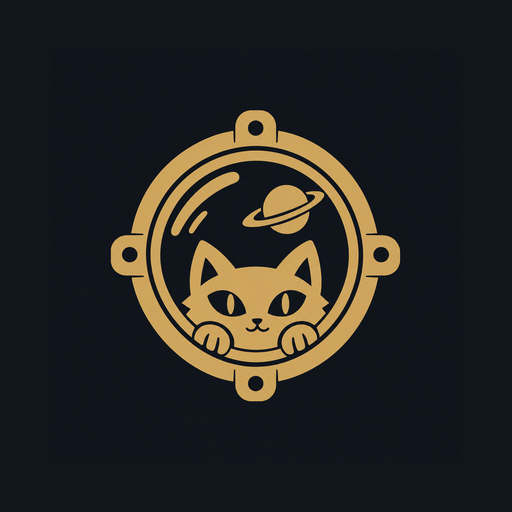
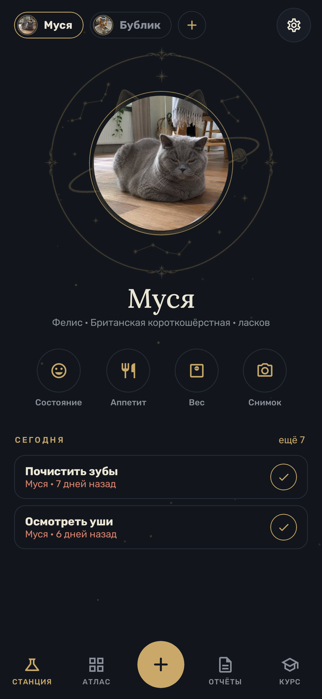
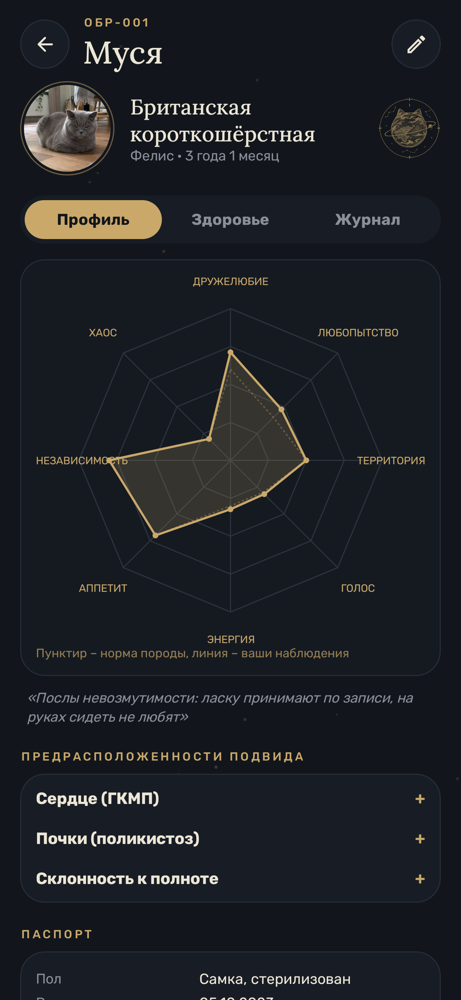
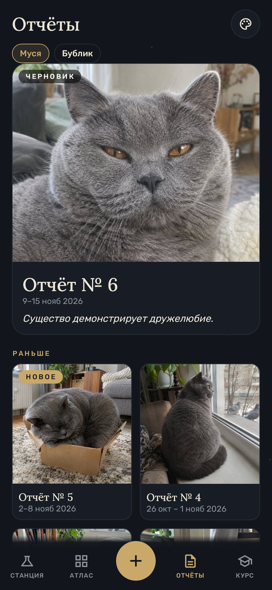
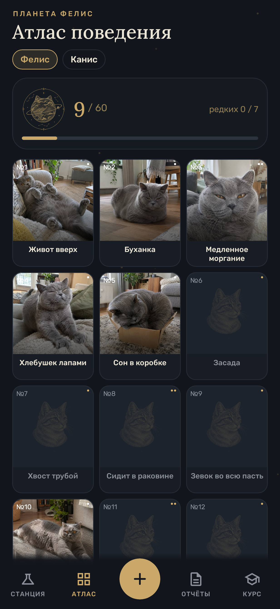

<h1 align="center">Контакт</h1>

Дневник питомца, который на самом деле прилетел с другой планеты. 
<a href="https://bigdevwhale.github.io/stillcraft/apps/specimen/">Сайт</a> · <a href="https://github.com/bigdevwhale/specimen/releases/latest/download/Specimen.apk">Скачать APK</a> · <a href="README.md">English</a>

Ваша кошка, собака или попугай – посланник другой планеты, а вы – ксенолог, которому поручили за ним наблюдать. Отмечайте настроение, аппетит и вес, фотографируйте питомца, пробуйте новые корма – и раз в неделю получайте отчёт бюро: со снимками, выводами и тем, чему существо научилось.

## Что внутри

- **Шесть родных планет и 135 пород.** Кошки, собаки, попугаи, кролики и грызуны, хорьки, рептилии. Для каждой породы приложение знает характер, нормальный вес и болезни, к которым она склонна.
- **Записи в одно касание.** Состояние, аппетит, вес, стул, симптомы и заметки. Если что-то выглядит тревожно – кот не ест второй день или не может сходить в туалет, – приложение прямо скажет, что пора к ветеринару.
- **Уход.** Прививки, обработки от блох и глистов, когти, лоток, взвешивание. Список составляется под породу, а приложение напомнит, когда подходит срок.
- **Эксперименты.** Новый корм, лекарство, переезд или гости. Запишите, чего ожидаете, а через несколько дней – как всё прошло. Так складывается рацион: что питомцу нравится, а от чего он отказывается.
- **Этический комитет.** Он не пропустит розыгрыш с огурцом, наказания, голод и всё, что ядовито для вашего вида, – шоколад, виноград, лилии, человеческие лекарства.
- **Атлас поведения.** 200 поз и привычек: живот вверх, буханка, медленное моргание, сон в коробке. Отметьте позу на фото – она откроется в атласе, а рядом будет объяснение, что она значит.
- **Отчёт по воскресеньям.** Машинописный лист с вашими снимками и подписями к ним, профилем характера, весом и выводами вроде «Существо демонстрирует дружелюбие». Им можно поделиться картинкой.
- **Курс ксенологии.** 45 коротких уроков про язык тела, стресс, игру и питание. В каждом – задание, которое можно выполнить со своим питомцем, и один вопрос. За наблюдения и уроки дают гранты, и звание растёт от лаборанта до академика.
- **Выписка для ветеринара.** PDF с весом, прививками, лекарствами и реакциями на них, симптомами за два месяца и кормами, которые не подошли.
- **Светлая и тёмная тема.** Оформлено как старинный звёздный атлас: гравюры планет, медали званий и портреты животных.

## Установка

Скачайте [Specimen.apk](https://github.com/bigdevwhale/specimen/releases/latest/download/Specimen.apk) на телефон с Android 9 или новее, откройте файл и разрешите установку из этого источника.

## Приватность

Без рекламы, аккаунта и аналитики. Приложению не нужен интернет: всё хранится на телефоне. Подробнее – в [PRIVACY.md](PRIVACY.md).

## Лицензия

MIT
